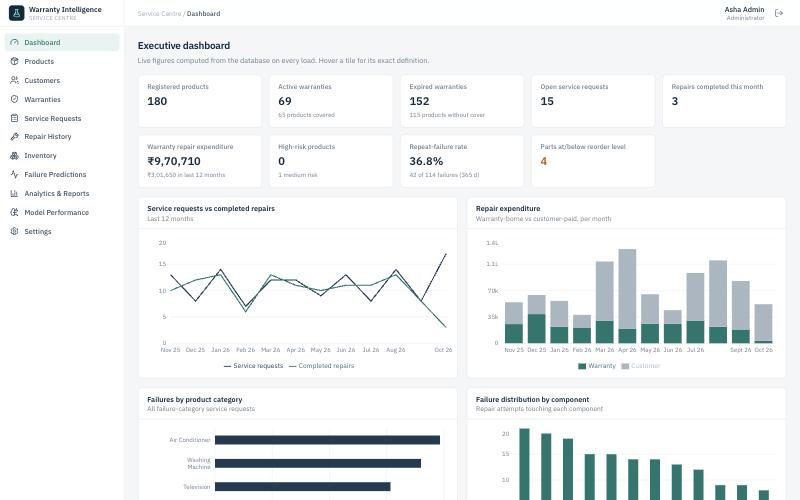

# Smart Warranty Intelligence & Failure Prediction System

A database-driven service-centre application for electronics warranties: customer and product
registry, warranty management with rule-based coverage decisions, the full service-request →
repair → inventory workflow, SQL analytics, and a leakage-safe machine-learning model that
estimates each unit's probability of failing again within 30 days.

Built as an academic **DBMS + Machine Learning** project. It runs end to end on a real
PostgreSQL database: nothing on screen is hard-coded, and the ML numbers come from an actual,
reproducible training run.

> **About the data and the model.** The bundled dataset is **synthetic** (fictional people, fixed
> random seed). The model trained on it is labelled **Demonstration** everywhere in the UI and API.
> Its metrics show that the pipeline is correct and honestly evaluated, not that it would perform
> this way on real data. See [docs/MACHINE_LEARNING.md](docs/MACHINE_LEARNING.md).



---

## Architecture

```
┌─────────────────────────┐   JSON / JWT    ┌──────────────────────────────┐  SQL  ┌─────────────────┐
│ React 18 + TypeScript   │ ──────────────► │ FastAPI  /api/v1             │ ────► │ PostgreSQL 16   │
│ Vite · Tailwind 4       │                 │  routers → services (flush)  │       │ 17 tables       │
│ Recharts · RHF + Zod    │ ◄────────────── │  one commit per request      │ ◄──── │ 10 views        │
│ React Router            │                 │  SQLAlchemy 2 · Pydantic 2   │       │ Alembic-managed │
└─────────────────────────┘                 │  ml/: features → train →     │       └─────────────────┘
                                            │       predict (scikit-learn) │
                                            │  model_artifacts/*.joblib    │
                                            └──────────────────────────────┘
```

| Layer | Technology |
|---|---|
| Frontend | React 18, TypeScript, Vite 6, Tailwind CSS 4, Recharts, React Router 6, React Hook Form + Zod, Lucide icons |
| Backend | Python 3.12, FastAPI, SQLAlchemy 2, Alembic, Pydantic 2, PyJWT, psycopg 3 |
| Database | PostgreSQL 16 (tests also run on PostgreSQL, in a separate `warranty_test` database) |
| ML | pandas, NumPy, scikit-learn (Random Forest, Gradient Boosting), joblib |
| Tests | pytest (backend + ML), Vitest + Testing Library (frontend) |

## Project structure

```
.
├── backend/
│   ├── app/
│   │   ├── api/v1/          # REST routers (auth, customers, products, warranties, service-requests,
│   │   │                    #   repairs, inventory, predictions, models, analytics, settings)
│   │   ├── core/            # config, DB session, JWT/password hashing, errors, auth dependencies
│   │   ├── models/          # SQLAlchemy models (all tables, constraints, indexes)
│   │   ├── schemas/         # Pydantic request/response validation
│   │   ├── services/        # business logic: warranty rules, request workflow, inventory, analytics, audit
│   │   └── ml/              # features.py · dataset.py · training.py · predictor.py
│   ├── alembic/versions/    # 0001 schema · 0002 views + default settings
│   ├── scripts/             # seed.py · train_model.py · export_sql.py · gen_schema_doc.py
│   ├── sql/                 # schema.sql (DDL) · analytics_queries.sql (reports, runnable in psql)
│   ├── tests/               # 49 pytest tests
│   └── model_artifacts/     # trained demonstration model (joblib)
├── frontend/src/
│   ├── pages/               # 11 pages + detail pages
│   ├── components/          # workflow modals + ui/ (table, forms, modal, toast, charts, states)
│   ├── lib/                 # API client, auth, hooks, formatting, types
│   └── test/                # 17 Vitest tests
├── dbms_documentation/      # ER diagram, relational schema, normalization, SQL, design decisions
├── docs/                    # MACHINE_LEARNING.md · openapi.json · screenshots/
├── docker-compose.yml       # PostgreSQL (+ optional api/web services, profile "app")
└── .env.example
```

---

## Setup

### Prerequisites

- Python **3.12** (3.11 also works), Node.js **20+**, PostgreSQL **16** (local install *or* Docker)
- [uv](https://docs.astral.sh/uv/) is optional; plain `python -m venv` + `pip` works too

### 1. Configure the environment

```bash
cp .env.example .env
```

Edit `.env`: set `POSTGRES_PASSWORD`, put the same password in `DATABASE_URL` and
`TEST_DATABASE_URL`, and set `JWT_SECRET` (generate one with
`python3 -c "import secrets; print(secrets.token_urlsafe(48))"`) and `DEMO_USER_PASSWORD`.

### 2. Start PostgreSQL

**Option A: Docker**

```bash
docker compose up -d db
```

This creates `warranty_db` and, through `docker/initdb`, the test database `warranty_test`.

**Option B: a local PostgreSQL** (replace `change_me` with your password):

```bash
psql -d postgres -c "CREATE ROLE warranty LOGIN PASSWORD 'change_me';"
```

```bash
createdb -O warranty warranty_db
```

```bash
createdb -O warranty warranty_test
```

### 3. Backend: install, migrate, seed, train

```bash
cd backend
```

```bash
python3.12 -m venv .venv
```

```bash
.venv/bin/pip install -r requirements.txt
```

```bash
.venv/bin/alembic upgrade head
```

```bash
.venv/bin/python -m scripts.seed --reset
```

```bash
.venv/bin/python -m scripts.train_model --predict-all
```

- `alembic upgrade head` creates all tables, constraints, indexes and views.
- `scripts.seed --reset` **wipes** all application data and loads the synthetic demonstration
  dataset (100 customers, 180 products, 29 models from 7 manufacturers, 235 warranties,
  303 service requests, 325 repairs, 26 components, 44 parts, 10 technicians, 4 user accounts).
  It refuses to run on a non-empty database without `--reset`. Add `--anchor-date 2026-10-15` to
  reproduce exactly the dataset and metrics documented here; by default the history ends today.
- `scripts.train_model --predict-all` trains, evaluates and registers the model, then scores
  every active product. Training is also available from the **Model Performance** page.

### 4. Run the API

```bash
.venv/bin/uvicorn app.main:app --reload --port 8000
```

### 5. Run the web app (new terminal, from the repository root)

```bash
cd frontend
```

```bash
npm install
```

```bash
npm run dev
```

| URL | What |
|---|---|
| http://localhost:5173 | Web application |
| http://localhost:8000/docs | Swagger / OpenAPI UI (disabled when `APP_ENV=production`) |
| http://localhost:8000/health | Health check (API + database) |

### Demo accounts (development seed only)

| Username | Role | Can |
|---|---|---|
| `admin` | Administrator | Everything, including settings |
| `manager` | Service manager | Warranties, inventory changes, batch scoring, model training (dev) |
| `tech.ravi`, `tech.sunita` | Technician | Work on their own assigned requests |

The password is the `DEMO_USER_PASSWORD` value from `.env`. With `APP_ENV=production`, the seed
generates random passwords instead and prints them once.

### Docker (whole stack)

Verified on 2026-10-15 with Docker Desktop (Engine 29.6, Compose v5.3): all three images build,
migrations run on startup, and the seed, training, browser login and `/health` all work.

```bash
docker compose --profile app up --build -d
```

Then run the one-off commands inside the `api` container:

```bash
docker compose exec api python -m scripts.seed --reset
```

```bash
docker compose exec api python -m scripts.train_model --predict-all
```

| URL | What |
|---|---|
| http://localhost:8080 | Web application (nginx, client-side routes fall back to `index.html`) |
| http://localhost:8000/health | Health check, returns `{"status":"ok","database":"ok"}` |
| http://localhost:8000/docs | Swagger / OpenAPI UI |

Log in with a demo account and the `DEMO_USER_PASSWORD` from `.env`. The trained model is kept
in the `artifacts` volume, and the database in `pgdata`. `docker compose --profile app down -v`
removes both.

**Port clashes.** The host ports default to 5432 (db), 8000 (api) and 8080 (web). Override them
with `POSTGRES_HOST_PORT`, `API_HOST_PORT` and `WEB_HOST_PORT` if something already listens
there, for example a Homebrew PostgreSQL:

```bash
POSTGRES_HOST_PORT=5433 docker compose --profile app up --build -d
```

Stop a local `uvicorn --port 8000` before you start the stack. Otherwise `127.0.0.1:8000` may
reach the local server instead of the container. The web image is built to call
`http://localhost:8000/api/v1`, so if you change `API_HOST_PORT` you must also change
`VITE_API_BASE_URL` in `docker-compose.yml`.

---

## Testing

```bash
cd backend && .venv/bin/python -m pytest
```

```bash
cd frontend && npm test
```

```bash
cd frontend && npm run build
```

Results from the final run (2026-10-15):

| Suite | Result |
|---|---|
| Backend + ML (pytest, real PostgreSQL) | **49 passed** |
| Frontend (Vitest + Testing Library) | **17 passed** |
| TypeScript typecheck + production build | **passed** |
| Exported `sql/schema.sql` applied to an empty database | 18 tables (incl. `alembic_version`) + 10 views, no errors |
| `sql/analytics_queries.sql` run in psql | 0 errors |
| Alembic `upgrade head` → `downgrade base` → `upgrade head` | passed |

The backend suite drops and re-creates the test schema through the real Alembic migrations,
then covers:

- customer and product creation, serial-number uniqueness;
- warranty coverage rules (dates, voided warranties, customer-induced damage, wear and tear,
  non-failure visits), expiry and extension;
- service-request state transitions;
- repair creation, transactional inventory deduction **and rollback**, idempotent resubmission,
  and cost and warranty-split calculation;
- RESTRICT / CHECK / partial-unique integrity, and the role-based authorization rules;
- analytics correctness as data changes;
- ML: feature values, **future-leakage prevention**, target construction and censoring,
  missing values and unseen categories, temporal split gap, metric calculation, model
  serialization, the probability constraint, model-unavailable (503) behaviour, the
  insufficient-data path, and a full seed → train → predict run.

The frontend tests cover data loading, loading, empty and error states, form validation, table
filtering through the API, login, and the repair workflow (stock validation, cost preview,
API error display, idempotency-key reuse on retry).

---

## Features

### Modules (all connected to the API; no placeholder controls)

| Page | Highlights |
|---|---|
| **Dashboard** | 10 KPI tiles, each with its definition on hover; 6 charts (requests vs repairs, expenditure, failures by category / component, top defects, risk distribution); top components, models and low-stock tables |
| **Products** | Search and filters (serial / customer, category, manufacturer, status, coverage, risk), sorting, pagination; registration with cascading model selection, serial generation and an automatic manufacturer warranty; **product profile** with owner, warranties, service and repair timeline, parts replaced, costs, latest prediction with factors, and prediction history |
| **Customers** | Search, city filter, sort; create and edit with validation; deletion blocked while products exist |
| **Warranties** | Contracts with *derived* status; register, **extend** (chained after current coverage), void; expiring-soon list; claims history with recorded decisions; expenditure analysis |
| **Service requests** | Pipeline view and filters; intake with a **live warranty-coverage check**; detail page with lifecycle stepper, assignment, validated transitions, repair attempts with parts (live cost preview, stock-aware), and atomic **complete & resolve** |
| **Repair history** | All attempts with filters (date range, category, manufacturer, model, component, severity, outcome, repeat-only) plus **defect analytics**: frequently replaced components, repeated failures, recurring faults in a window, high-cost models, repeat-prone components, MTTR, first-time-fix rate, claims by period |
| **Inventory** | Parts with low-stock alerts; create and edit; restock and authorized adjustments with reasons; per-part usage, consumption chart and ledger; full transaction history; cost analysis |
| **Failure predictions** | Current or historical predictions, filters, batch scoring; risk bands shown separately from the validated decision threshold; demonstration labelling |
| **Analytics & reports** | 12 parameterized SQL reports with the SQL shown, concepts tagged, and CSV export |
| **Model performance** | Model status (validated / demonstration / unavailable), test metrics vs baselines, confusion matrix, calibration, grouped and per-feature importance, split design, training-run history, retrain button |
| **Settings** | Risk bands and analytic windows (admin), technicians, audit log |

### Core rules worth knowing

- **Coverage is decided, not assumed.** `services/warranty.py::evaluate_coverage` checks dates,
  administrative state, exclusions and covered terms. The decision and its reasons are recorded
  on the request.
- **One transaction per workflow step.** A repair, its parts, the stock deduction, the inventory
  ledger and the audit entry commit together or not at all. Rows are locked with
  `SELECT … FOR UPDATE`, and duplicate submissions are neutralised by idempotency keys.
- **Invalid states are impossible.** Transitions are validated in code and backstopped by
  database CHECK constraints.
- **History is never overwritten.** Predictions, training runs, inventory movements and audit
  entries are append-only, and the cost at repair time is frozen.

### Security and reliability

- JWT authentication on every endpoint; passwords hashed with PBKDF2-SHA256 (310k iterations).
- Role-based authorization: technicians are limited to their own assignments. Inventory changes,
  warranty changes and batch scoring require a manager; settings require an admin. Training
  requires a manager in development and an **admin in production**.
- Server-side validation (Pydantic) plus database constraints. Errors use one JSON shape:
  `{"error": {"code", "message", "details"}}`. Constraint violations map to friendly messages,
  and unexpected errors never leak internals.
- All SQL is parameterized. Report parameters are type- and range-checked against an allow-list.
- Secrets come only from the environment (`.env`, git-ignored); `.env.example` has placeholders.
- Timestamps are stored as `TIMESTAMPTZ` with sessions pinned to UTC; money is `NUMERIC(12,2)`.
- An audit log records logins, warranty registration, extension and voiding, request status
  changes, repairs, inventory movements, predictions, training and settings changes.

### API

Versioned REST API under `/api/v1`, with 63 operations. The interactive documentation is at
`/docs`, and the full spec is in [docs/openapi.json](docs/openapi.json). Main endpoints:

```
POST /auth/login                      GET  /auth/me
GET  /dashboard/summary               GET  /dashboard/trends
GET|POST /customers                   GET|PATCH|DELETE /customers/{id}
GET|POST /products                    GET  /products/{id}          GET /products/{id}/history
GET  /products/serial-suggestion      PATCH /products/{id}
GET|POST /warranties                  POST /warranties/{id}/extend POST /warranties/{id}/void
GET  /warranties/expiring             GET  /warranties/coverage-check
GET  /warranties/claims               GET  /warranties/expenditure
GET|POST /service-requests            GET|PATCH /service-requests/{id}
POST /service-requests/{id}/repairs   POST /service-requests/{id}/complete
GET  /repairs                         GET  /analytics/defects
GET|POST /inventory/parts             GET|PATCH /inventory/parts/{id}
POST /inventory/parts/{id}/adjust     GET  /inventory/low-stock     GET /inventory/transactions
GET  /inventory/cost-analysis
GET  /predictions                     POST /predictions/{product_id}/generate
POST /predictions/generate-batch
GET  /models/status  GET /models/metrics  GET /models/runs  POST /models/train
GET  /analytics/reports               GET  /analytics/{report_name}
GET  /catalog/{categories|manufacturers|product-models|fault-categories|components}
GET|POST /technicians                 PATCH /technicians/{id}
GET|PUT /settings                     GET  /audit-logs
```

List endpoints are paginated (`page`, `page_size` ≤ 100) and return
`{items, total, page, page_size}`.

### DBMS deliverables

[dbms_documentation/](dbms_documentation/):

- [ER_DIAGRAM.md](dbms_documentation/ER_DIAGRAM.md): Mermaid ER diagram and a cardinality table
- [RELATIONAL_SCHEMA.md](dbms_documentation/RELATIONAL_SCHEMA.md): every table, column, key,
  constraint and index, generated from the models
- [NORMALIZATION.md](dbms_documentation/NORMALIZATION.md): from 1NF to 3NF/BCNF, functional
  dependencies, and the deliberate redundancy with its justification
- [SQL_QUERIES.md](dbms_documentation/SQL_QUERIES.md): views, the 12 reports, metric
  definitions, and a map of DBMS concepts
- [DATABASE_DESIGN_DECISIONS.md](dbms_documentation/DATABASE_DESIGN_DECISIONS.md)

The SQL itself lives in [backend/sql/schema.sql](backend/sql/schema.sql) and
[backend/sql/analytics_queries.sql](backend/sql/analytics_queries.sql). Regenerate both with
`python -m scripts.export_sql`.

### Machine learning summary

Random Forest predicting another qualifying failure within 30 days. It uses point-in-time
features, a temporal train/validation/test split, and baselines; the threshold is chosen on
validation data. Held-out test results on the synthetic data:

| | PR-AUC | ROC-AUC | Recall @ threshold | Brier |
|---|---|---|---|---|
| Prior-rate baseline | 0.043 | 0.500 | n/a | 0.041 |
| Recent-failure rule | 0.080 | 0.630 | n/a | 0.040 |
| **Random Forest (demonstration)** | **0.199** | **0.786** | 0.483 | **0.039** |

Full method, results and caveats are in [docs/MACHINE_LEARNING.md](docs/MACHINE_LEARNING.md).

---

## Known limitations and future work

- **No real data.** The shipped model is a demonstration on synthetic data. A `validated` model
  requires operational history; the evidence rules are in the ML document.
- **Absolute risk is low by construction.** Monthly failure rates are about 4%, so nearly all
  units fall in the Low band. The validated decision threshold (≈ 0.10) is the operational
  signal; bands are configurable.
- **Training runs synchronously** in the API request (about 10–20 s on this dataset). A
  production deployment should use a job queue.
- **Product ownership history** is not modelled; `products.customer_id` is the current owner.
- **Voided-warranty timing**: the warranty table stores administrative state, not when it
  changed, so the ML features read the current state. This is a minor potential leak for
  voided warranties, and is documented.
- **No refresh tokens or rate limiting.** JWTs live in `localStorage` and expire after
  `ACCESS_TOKEN_MINUTES`. Production would add refresh tokens, HTTPS-only cookies and
  login rate limiting.
- **PII**: contact data is stored in plain text. Production should add encryption at rest and a
  retention policy.
- **Responsive design** targets desktop and tablet; on phones the sidebar collapses to icons, but
  dense tables scroll horizontally.
- Possible extensions: an SLA / turnaround tracking table, supplier purchase orders, per-category
  probability calibration, and model drift monitoring.
