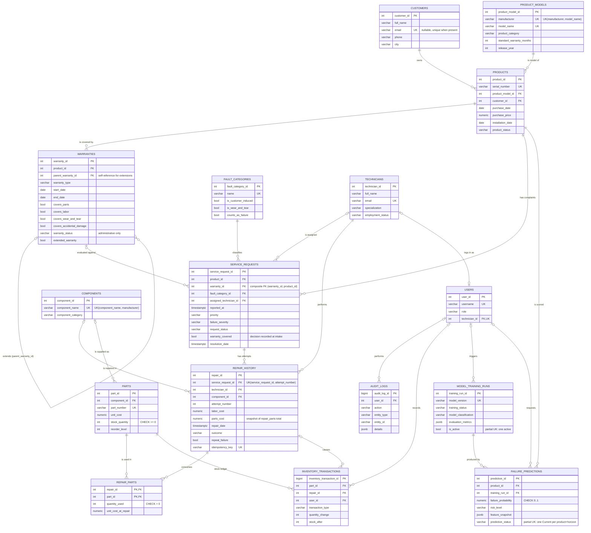

# Entity–Relationship Diagram

The diagram below is Mermaid `erDiagram` syntax (renders on GitHub, in VS Code with a Mermaid
extension, or at mermaid.live). Crow's-foot notation: `||` exactly one, `o|` zero or one,
`|{` one or more, `o{` zero or more. Only keys and the attributes that matter for the
relationships are shown; see [RELATIONAL_SCHEMA.md](RELATIONAL_SCHEMA.md) for every column.

`APP_SETTINGS` (key/value configuration) has no relationships and is omitted from the diagram.

## Relationships and cardinalities

| Relationship | Type | Cardinality & participation | Implemented by |
|---|---|---|---|
| Customer **owns** Product | 1 : N | A product has exactly one current owner (total); a customer may own zero or more products (partial). | `products.customer_id` NOT NULL FK |
| Product Model **is model of** Product | 1 : N | Every product has exactly one model; a model may have zero units registered. | `products.product_model_id` NOT NULL FK |
| Product **is covered by** Warranty | 1 : N | A warranty belongs to exactly one product; a product has zero or more warranties, **at most one** of type Manufacturer. | `warranties.product_id` FK + partial unique index |
| Warranty **extends** Warranty | 1 : N (recursive / unary) | An extension optionally points to the warranty it extends; manufacturer warranties never have a parent. | `warranties.parent_warranty_id` self-FK + CHECK |
| Product **has** Service Request | 1 : N | Every request concerns exactly one product. | `service_requests.product_id` NOT NULL FK |
| Warranty **evaluated for** Service Request | 1 : N, optional | A request references zero or one warranty, which must belong to the **same product**. | Composite FK `(warranty_id, product_id) → warranties(warranty_id, product_id)` |
| Fault Category **classifies** Service Request | 1 : N | Every request has exactly one fault category. | `service_requests.fault_category_id` NOT NULL FK |
| Technician **is assigned** Service Request | 1 : N, optional | Zero or one technician; required (CHECK) once status is Assigned / In Progress. | Nullable FK + CHECK |
| Service Request **has** Repair attempt | 1 : N (weak-entity style) | A repair belongs to exactly one request; attempts are numbered 1..n per request. | NOT NULL FK + UNIQUE(service_request_id, attempt_number) |
| Technician **performs** Repair | 1 : N | Every repair has exactly one technician. | NOT NULL FK |
| Component **is repaired in** Repair | 1 : N, optional | Software-only repairs have no component. | Nullable FK |
| Repair **consumes** Part | **M : N** | A repair uses zero or more parts; a part is used in zero or more repairs. The relationship carries attributes (quantity, cost at repair). | Junction table `repair_parts`, composite PK (repair_id, part_id) |
| Component **is supplied as** Part | 1 : N, optional | | Nullable FK |
| Part **has** Inventory Transaction | 1 : N | The append-only stock ledger; consumption rows must reference a repair (CHECK). | NOT NULL FK + CHECK |
| Product **is scored by** Prediction | 1 : N | Historical predictions are kept; only one is `Current` per product and horizon. | FK + partial unique index |
| Training Run **produces** Prediction | 1 : N | Every prediction records the model run that produced it. | NOT NULL FK |
| Technician **logs in as** User | **1 : 1**, optional | A technician account is linked to exactly one technician record (UNIQUE FK); admins and managers have none. | `users.technician_id` UNIQUE FK + CHECK for role = technician |
| User **performs** Audit Log entry | 1 : N, optional | `ON DELETE SET NULL` keeps the audit trail if a user is removed. | Nullable FK |

## Entity notes

- **Strong entities**: customers, product_models, products, warranties, technicians, components, parts, fault_categories, users.
- **Weak-entity style**: `repair_history` is identified within its service request by `attempt_number` (it has its own surrogate key for convenience, but the business key is `(service_request_id, attempt_number)`).
- **Associative entity**: `repair_parts` resolves the many-to-many relationship and stores relationship attributes.
- **Derived / history entities**: `failure_predictions`, `model_training_runs`, `inventory_transactions` and `audit_logs` are append-oriented history tables; rows are never overwritten.
